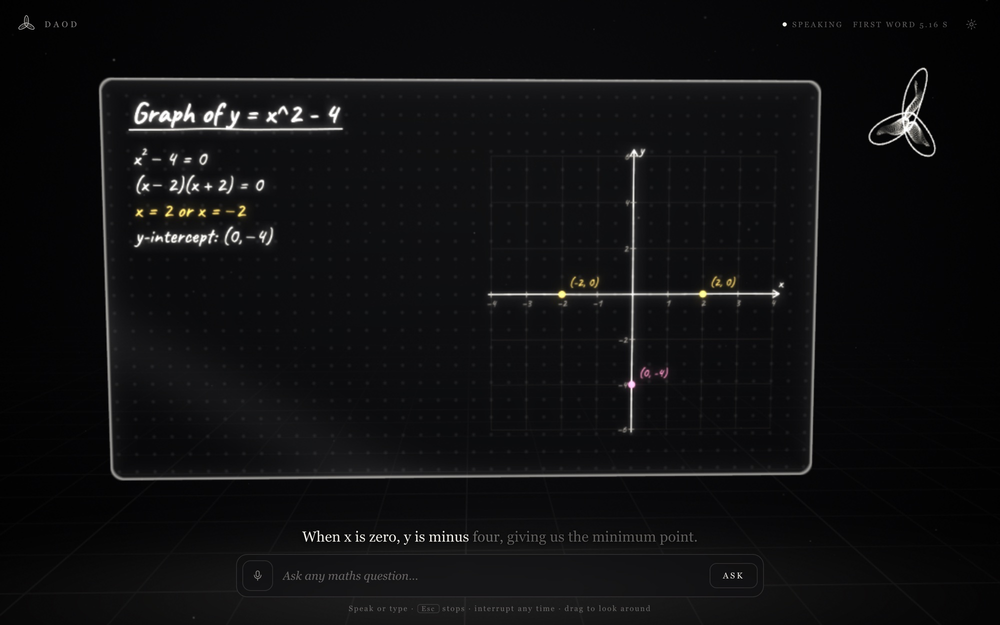
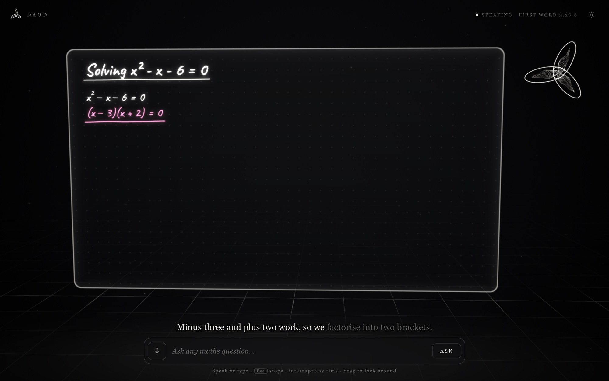
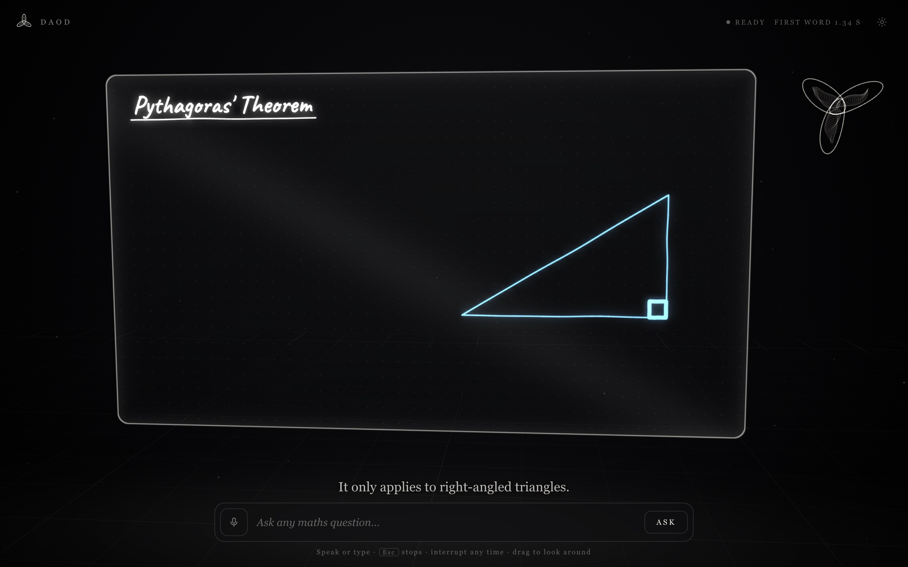
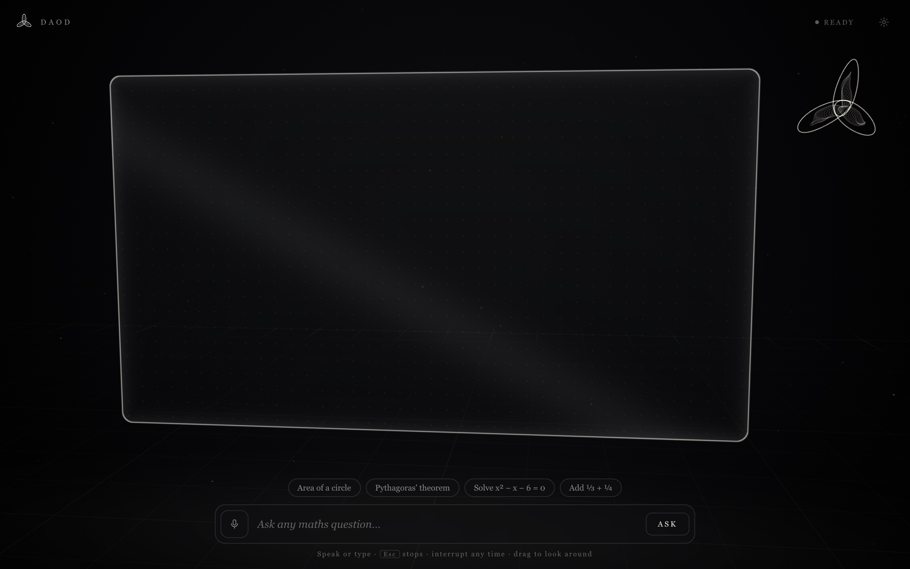

# DAOD

[](../../actions/workflows/ci.yml)


**An AI maths tutor that talks while it draws on a glass board floating in 3D — and stops the moment you cut in.**

Ask out loud (or type). DAOD starts speaking in a fraction of a second, writing the maths by hand on a translucent board as it explains. Say "wait, why?" mid‑sentence and it stops, listens, points at the bit you're confused about, answers, then picks the lesson back up.



<table>
  <tr>
    <td width="33%"></td>
    <td width="33%"></td>
    <td width="33%"></td>
  </tr>
  <tr>
    <td align="center"><sub>Solving a quadratic — the pen keeps pace with the voice</sub></td>
    <td align="center"><sub>Geometry, drawn by hand in real time</sub></td>
    <td align="center"><sub>The glass board in its WebGL2 room</sub></td>
  </tr>
</table>

<sub>All screenshots are live answers from `gemini-3.5-flash`, captured at 1440×900 in headless Chrome.</sub>

```
npm start            # zero dependencies — Node 18+ is all you need
open http://localhost:8787
```

No key? It runs in **demo mode** with four hand‑made lessons (circle area, Pythagoras, quadratics, fractions). Add a key for real answers to anything — Groq, Gemini, or any OpenAI‑compatible endpoint:

```
cp .env.example .env     # then set GROQ_API_KEY=gsk_...  (or the Gemini lines, see below)
npm start
```

## Engineering highlights

- **Streaming end to end.** The model streams NDJSON "beats"; an incremental JSON scanner on the server ([`server/beats.mjs`](server/beats.mjs)) emits each one the moment it closes, so the tutor speaks beat 1 while beat 4 is still being generated. Measured with Gemini: **first beat in ~1.9 s, a 5‑beat lesson complete in 2.7 s**; in demo mode the pipeline is ~170 ms.
- **Interruptible by design.** Barge‑in aborts the browser request, and the server propagates the `AbortSignal` upstream so the model stops generating (and billing) mid‑answer. The model is then told exactly what it was saying and what is on the board.
- **No frameworks.** A zero‑dependency Node HTTP server, a raw WebGL2 renderer (six draw calls, no Three.js), a canvas mini‑TeX typesetter, and a safe expression parser for plots instead of `eval`.
- **Untrusted model output is sanitised.** Every drawing op is validated and clamped before it reaches the browser; the API key never leaves the server.
- **Typed and tested.** JSDoc + `tsc --checkJs` across the client, `node --test` unit tests for the stream scanner, sanitiser, parser and lessons, and CI on every push.

---

## What changed from v1 (and why v1 felt broken)

| | v1 (Next.js) | v3 (this) |
|---|---|---|
| Time to first word | waited for the **whole lesson JSON** before any speech, then a TTS round trip | **streams beats**: speaks beat 1 while beat 2 is generated (see the latency budget below) |
| Voice | Kokoro in Docker (had to be running) | browser voice (instant, free) or Groq Orpheus with prefetch |
| Interrupting | pause button → separate request → appended steps | hands‑free barge‑in; echo‑proof; "okay" doesn't derail it |
| 3D | orthographic camera + DOM overlay (flat) | real WebGL2 scene: glass board, reflections, dust, the trefoil presence |
| Maths | KaTeX DOM nodes over the canvas | mini‑TeX typeset *into* the board texture, written stroke by stroke |
| Plots | `eval`‑style JS expressions | a safe parser that reads `2x`, `x^2`, `sin x`, `|x|` |
| Payload | Next + React + Three + GSAP + KaTeX + pg | **27 KB gzipped**, zero runtime dependencies |
| Infra | Postgres + Kokoro + Next | one Node file |

The old app is preserved untouched in [`legacy/v1-nextjs`](legacy/v1-nextjs).

## How it works

```
 you ──speech──▶ Ears ──partial words──▶ barge-in policy ──▶ Conductor ──POST──▶ server ──▶ LLM (stream)
      ──typing─────────────────────────────────────────────▶     │  ▲                 │
                                                                  │  └─ beats (NDJSON) ◀┘
                                              Voice ◀── say ──────┤
                                              Board ◀── draw ─────┘   (pen timed to the voice)
                                Board canvas ──texture──▶ Scene (WebGL2, one rAF loop)
```

### 1 · Beats: the voice drives the clock
*(idea from [khan-explainer](https://github.com/haiderfarooq3/khan-explainer))*

The model doesn't return a scene. It streams **beats** — one JSON object per line:

```json
{"say":"The area is pi times r squared.","draw":[{"t":"math","id":"f","s":"A = \\pi r^2","c":"yellow"}]}
```

A beat is one spoken clause plus what the pen draws *while it's said*. The conductor starts speaking the line and spreads the drawing over its duration, weighted by ink length, so the pen never runs ahead of the words. Because beats are independent, beat 1 plays while the model is still writing beat 4.

The server runs an incremental JSON scanner over the token stream ([`server/beats.mjs`](server/beats.mjs)), so it copes with code fences, missing newlines, top‑level arrays and objects split across chunks, and sanitises every op before it reaches the browser.

### 2 · The board: a real drawing surface
[`web/js/board/`](web/js/board) is a 1600×900 canvas with its own small vocabulary — `title text math line arrow circle arc rect poly axes plot dot mark erase clear` — documented for the model in [`server/prompt.mjs`](server/prompt.mjs).

- **Layout the model can't break.** Text and maths without coordinates flow down a writing column like a notebook; explicit labels that would land on other writing slide down; anything too wide shrinks to fit; a full column turns the page.
- **Hand‑drawn and deterministic.** Strokes wobble with sin‑based noise (never `Math.random`), so a stroke redrawn later lands on the same pixels; paths reveal by arc length so the pen moves at constant speed.
- **Cheap.** Finished strokes are baked once; each frame only redraws the 1–2 items being written, and only when something changed.
- **Speakable state.** `board.describe()` turns the board into a few lines (`#f math "A = \pi r^2" [70,209 219x71]`) that the model receives when interrupted, so it can `mark` exactly what you're asking about.

### 3 · The 3D world: raw WebGL2, six draw calls
[`web/js/gl/scene.js`](web/js/gl/scene.js), no Three.js:

1. background — one full‑screen triangle (void gradient, dithered)
2. floor — one quad, procedural grid + v1's scan line + a light pool under the glass
3. dust — ~900 points animated entirely in the vertex shader
4. reflection — the board mirrored under the floor, fading with depth
5. board — smoked glass with fresnel, bevelled rim, a dot grid, a slow sheen; the ink texture's **mip levels give the chalk glow for free**; a hot pen light where it's writing
6. presence — the DAOD trefoil (~4k line vertices) that breathes with the voice, spins while thinking, turns blue while listening

The ink texture is only re‑uploaded when the board changed; the renderer drops resolution if frames get slow and halves its frame rate when idle. Drag to orbit, scroll/pinch to zoom, double‑click to reset. Motion is eased with time‑based exponential smoothing *(principle from [anatomy](https://github.com/wheresryan22/anatomy): parts never snap; one loop drives everything; readouts show live, true numbers)* — hence the `FIRST WORD 0.42 S` readout in the corner.

### 4 · Interrupting
[`web/js/tutor/ears.js`](web/js/tutor/ears.js) keeps listening while the tutor talks:

- **Chrome / Edge / Safari:** the built‑in recogniser streams partial words in a few hundred ms.
- **Elsewhere:** an energy voice‑activity detector on the echo‑cancelled mic; the clip goes to Groq Whisper.

[`web/js/main.js`](web/js/main.js) decides what a sound *means*:

| heard | while the tutor is talking | result |
|---|---|---|
| its own words leaking back into the mic | ignored (echo filter) | keeps talking |
| "okay", "go on", "mm‑hmm" | ignored / resumes | keeps talking |
| "wait", "why…", any two new words | **hold**: voice stops, pen freezes | listening |
| …then a real question | the old answer is dropped, the half‑drawn stroke finishes, the model is told *exactly what it was saying* and what's on the board | answers, then "Right — back to where we were" |
| …then nothing / a false alarm | resumes the line | keeps talking |

The request is aborted the instant you interrupt, and the server propagates that abort to the model so it stops generating.

### Latency budget (Groq, browser voice)

Expected figures; the demo‑mode pipeline (server → stream → first spoken word) measures **~170 ms** end to end in a headless browser.

| step | expected |
|---|---|
| speech end → final transcript (Web Speech) | 150–400 ms |
| request → first token (`gpt-oss-120b`, reasoning low) | 150–350 ms |
| first token → first complete beat (~25 tokens at ~500 tok/s) | ~50 ms |
| beat → first audible word (`speechSynthesis`) | ~50 ms |
| **typed question → first word** | **≈ 0.3–0.6 s** |

With the natural Orpheus voice add one TTS round trip (~300–500 ms) to the *first* beat only; later beats are prefetched while earlier ones play. The readout in the top‑right shows the real number for every answer.

## Configuration

Everything is optional; see [`.env.example`](.env.example).

| variable | default | |
|---|---|---|
| `GROQ_API_KEY` | — | enables real lessons, Orpheus voice, Whisper ears |
| `LLM_MODEL` | `openai/gpt-oss-120b` | try `openai/gpt-oss-20b` (faster) or `llama-3.3-70b-versatile` |
| `LLM_REASONING_EFFORT` | `low` | for reasoning models |
| `LLM_BASE_URL` / `LLM_API_KEY` | Groq | **any OpenAI‑compatible server** — e.g. open‑source models via Ollama (`http://localhost:11434/v1`) or LM Studio |
| `TTS_MODEL` / `TTS_VOICE` | `canopylabs/orpheus-v1-english` / `autumn` | |
| `STT_MODEL` | `whisper-large-v3-turbo` | |
| `PORT` | `8787` | |

**Using Gemini** (via Google's OpenAI‑compatible endpoint; Gemini models get `reasoning_effort` too, which keeps the first word fast):

```
LLM_BASE_URL=https://generativelanguage.googleapis.com/v1beta/openai
LLM_MODEL=gemini-3.5-flash
LLM_API_KEY=your-gemini-key
```

Measured first‑token latency on the same short prompt: `gemini-3.5-flash-lite` ~0.7 s, `gemini-3.5-flash` ~2.9 s, `gemini-3.8-flash` 30 s+ — pick flash for quality, flash‑lite for speed.

In the app: ⚙ → voice engine (browser / Orpheus / captions only), browser voice, speed.
Keys: <kbd>Space</kbd> hands‑free mic · <kbd>Esc</kbd> stop · <kbd>R</kbd> reset view · just start typing to ask.

## Project layout

```
server/
  server.mjs      zero-dependency HTTP server: static files, /api/lesson stream, /api/tts, /api/stt
  prompt.mjs      the tutor's instructions + the beat/op protocol
  beats.mjs       streaming JSON scanner + op sanitiser
web/
  index.html  styles.css  assets/logo.svg
  js/main.js            wiring, barge-in policy, captions, the single animation loop
  js/gl/scene.js        the WebGL2 world
  js/board/board.js     layout, items, baking, describe()
  js/board/ink.js       hand-drawn stroke geometry
  js/board/mathtex.js   mini-TeX typesetter (canvas)
  js/board/expr.js      safe function parser for plots
  js/tutor/conductor.js beats → performance; hold / resume / interrupt
  js/tutor/voice.js     browser / Orpheus / silent voices
  js/tutor/ears.js      Web Speech, or VAD + Whisper
  js/tutor/api.js       NDJSON stream client (+ offline demo fallback)
  js/tutor/demo.js      hand-made lessons (demo mode, tests, examples)
scripts/build.mjs       optional: minified bundle, or a single-file standalone HTML
tests/                  unit tests (node --test) + a headless browser check
legacy/v1-nextjs/       the original DAOD, untouched
```

## Develop

```
npm run dev          # serves web/ unbundled, restarts the server on change
npm test             # unit tests: stream scanner, sanitiser, expression parser, demo lessons
npm install && npm run check        # type-check the JSDoc-annotated client with tsc
npm install && npm run build        # dist/ — `npm start` then serves the bundle
npm run build -- --standalone       # dist/daod-standalone.html — the whole client in one file
python3 tests/e2e.py                # headless Chromium run of a lesson + interruptions (needs playwright)
```

The client is plain ES modules with JSDoc types (`// @ts-check`) — no build step is needed to run it.

## Next steps

- **Follow‑the‑pen camera on phones** (the 16:9 board is small in portrait; zoom to where it's writing).
- **Streaming TTS** so the first Orpheus beat starts before its whole clip is synthesised.
- **Lesson memory**: let the student scroll back through earlier pages of the board.
- **More ops**: number lines, angle markers with labels, shaded regions between curves, 3D surfaces off the glass.
